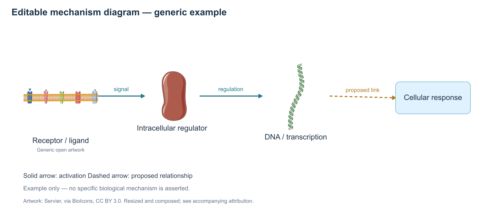

# Biomedical Illustration · 科研机制图素材库

本地 Codex 插件：下载即用的开放科研 SVG 素材库，支持中英文检索、素材预览、BioRender 导入素材包，以及可编辑的生物机制图组装。



> 图为插件功能示例，不代表特定的生物学机制。

## 功能

- 离线检索细胞、细胞器、DNA、蛋白、受体和实验设备等素材。
- 生成自包含 HTML 素材预览。
- 导出原始 SVG、作者与来源记录、署名说明和适用的许可全文。
- 按 JSON 场景组装可编辑 SVG，支持激活箭头、抑制端线、关联线和虚线。
- 可选生成 PNG 预览。核心功能使用 Python 3.9+ 标准库，无需 API Key。

## 安装到 Codex

```bash
codex plugin marketplace add Senki-zip/codex_Biomedical_Illustration
codex plugin add bio-mechanism@biomedical-illustration
```

安装后打开新对话；若技能未显示，重启 Codex。可以直接输入：

> 使用科研机制图素材库，寻找细胞核、DNA 和蛋白的素材，先给我预览，再根据以下机制关系组装可编辑 SVG：……

也可以先克隆仓库，再注册本地市场：

```bash
git clone https://github.com/Senki-zip/codex_Biomedical_Illustration.git
codex plugin marketplace add ./codex_Biomedical_Illustration
codex plugin add bio-mechanism@biomedical-illustration
```

本仓库直接包含素材文件，原始素材体积约 449 MB；首次安装需要下载它们。插件与技能入口分别位于 `plugins/bio-mechanism/plugin.json` 和 `plugins/bio-mechanism/skills/bio-mechanism/SKILL.md`。

## Skills 使用方法

插件内包含两个可调用的 skills：

| Skill | 用途 | 示例 |
| --- | --- | --- |
| [`bio-mechanism-guide`](plugins/bio-mechanism/skills/bio-mechanism-guide/SKILL.md) | 使用指南、素材库检查和首次使用引导 | `使用 $bio-mechanism-guide，教我用这个插件画机制图。` |
| [`bio-mechanism`](plugins/bio-mechanism/skills/bio-mechanism/SKILL.md) | 检索、预览、导出素材和组装机制图 | `使用 $bio-mechanism，找到 DNA、细胞核和蛋白素材，并生成候选图册。` |

在 Codex 中输入 `$` 可查找已加载的 skill，也可以直接描述任务，由 Codex 自动选择。使用指南同时作为插件的 onboarding skill；支持该入口的客户端可在插件安装后的设置／开始使用入口中调用它。

常用提示语：

```text
使用 $bio-mechanism-guide，检查素材库并介绍操作方法。

使用 $bio-mechanism，找 6 个 CC0 的细胞和核酸图标，导出 SVG、来源及署名文件，供我上传到 BioRender。

使用 $bio-mechanism，绘制以下机制：A 激活 B，B 抑制 C，B 到 D 为待验证关系。提供可编辑 SVG、PNG 预览和素材署名。
```

绘图时提供核心分子、所在细胞／细胞器、激活或抑制关系、待验证关系及版式要求，有助于准确选择素材和安排布局。

## 命令行使用

从克隆的仓库根目录执行：

```bash
BIO_SKILL_DIR="./plugins/bio-mechanism/skills/bio-mechanism"

# 中英文检索、生成候选图册
python3 "$BIO_SKILL_DIR/scripts/bioassets.py" search '细胞核 DNA 受体' --limit 16 --gallery ./candidates.html

# 限定作者或许可
python3 "$BIO_SKILL_DIR/scripts/bioassets.py" search receptor --author Servier --limit 12
python3 "$BIO_SKILL_DIR/scripts/bioassets.py" search DNA --license cc-0 --limit 12

# 导出原始 SVG 与署名文件
python3 "$BIO_SKILL_DIR/scripts/bioassets.py" export bio-94be01feee5b bio-1161c95976be --out ./materials

# 生成可编辑 SVG 示例
python3 "$BIO_SKILL_DIR/scripts/bioassets.py" compose --spec "$BIO_SKILL_DIR/assets/examples/generic-mechanism.scene.json" --out ./mechanism.svg

# 检查素材完整性
python3 "$BIO_SKILL_DIR/scripts/bioassets.py" stats --verify
```

场景格式见 [scene-format.md](plugins/bio-mechanism/skills/bio-mechanism/references/scene-format.md)。PNG 预览脚本需要 Node.js 和可选的 `sharp`；支持从普通 Node 模块路径或本机 Codex 随附运行库加载：

```bash
node "$BIO_SKILL_DIR/scripts/render.cjs" ./mechanism.svg ./mechanism.png 1800
```

## 素材范围与质量

素材来自 [BioIcons](https://github.com/duerrsimon/bioicons)，固定于提交 `d29e766ea7580b8063c4f47b29e872db40a4d979`，包含 Servier、DBCLS 和其他作者的作品。

| 项目 | 数量 |
| --- | ---: |
| 保留的原始 SVG 文件 | 2,830 |
| 已索引素材 | 2,829 |
| 默认可检索和组图的 SVG | 2,825 |
| 上游损坏 SVG，保留但排除使用 | 4 |
| 缺少作者目录，未索引的 SVG | 1 |

索引按实际文件构建；每个素材记录作者、许可、来源 URL 和 SHA-256。校验与功能测试记录见 [validation.json](docs/validation.json)。本仓库未包含 NIH BioArt 或 Reactome 的完整素材库，详细状态见 [sources.json](plugins/bio-mechanism/skills/bio-mechanism/assets/library/sources.json)。

## 用于 BioRender

将导出的 SVG 通过 BioRender 的 Uploads 上传；保存素材包附带的 `ATTRIBUTION.md`、`assets.json` 和 `licenses/`。SVG 上传后能否逐路径编辑取决于 BioRender 的导入行为。本插件不会连接 BioRender 账号，不提供 BioRender 专有素材或订阅权益。

## 许可与署名

本插件的代码和说明使用 [MIT License](LICENSE)。**素材使用各自的上游许可，不能将整个素材库视为 MIT 或公共领域。**

素材包括 CC0、CC BY 3.0/4.0、CC BY-SA 3.0/4.0、MIT 和 BSD。请遵守对应条目的署名、修改说明、许可通知和其他要求。许可全文随素材保留，索引见 [index.json](plugins/bio-mechanism/skills/bio-mechanism/assets/library/index.json)。

Servier 在本 BioIcons 快照中的部分素材为 CC BY 3.0；不会因为官网当前许可变化而自动改写历史快照的许可。示例素材的署名见 [example-sources](docs/example-sources/ATTRIBUTION.md)。

## 上游来源

- [BioIcons](https://bioicons.com/)
- [Servier Medical Art](https://smart.servier.com/)
- [DBCLS TogoTV](https://togotv.dbcls.jp/en/pics.html)
- [Codex 插件打包说明](https://developers.openai.com/plugins/build/plugins)
