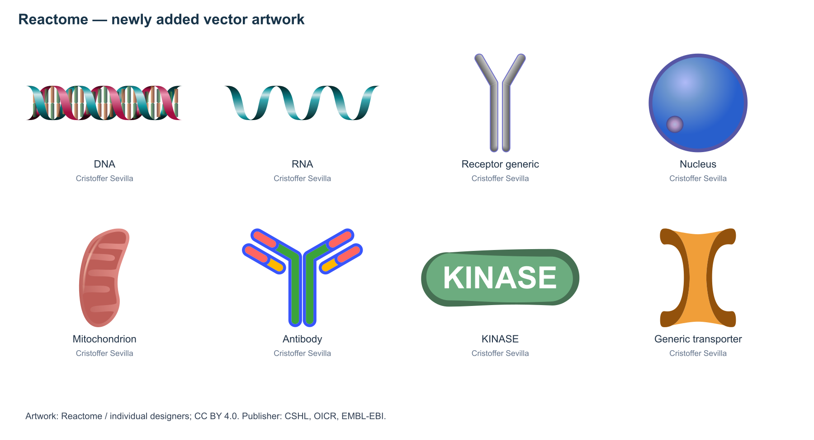

# Library expansion record · November 7, 2026

The library expansion was released in plugin version 1.1.0.

- BioIcons was checked against the latest main commit using Git blob hashes for 2,846 files. The pinned commit remained current and required zero downloads.
- All 2,571 Reactome catalog SVGs were downloaded successfully. Records include icon IDs, designers, designer URLs, descriptions, sources, and CC BY 4.0 licensing, with publisher attribution to CSHL, OICR, and EMBL-EBI.
- The combined library has 5,400 indexed records and 5,396 parseable SVGs. Content deduplication yields 5,393 usable icons. Four malformed upstream files and one unindexed original with a missing author directory are retained for provenance.
- SHA-256 verification passed for all 5,400 indexed files.
- Five behavior tests passed, covering preservation of other sources during updates, deduplication and source filtering, distinct license notices, standard SVG entities, invalid source rejection, and retention of Reactome records during legacy archive imports.
- Selected artwork was used to generate SVG and PNG previews with attribution, and the rendered result was visually inspected.

The complete machine-readable record is available in the [audit JSON](library-update-2026-11-07.json). Reactome publishes its licensing declaration on the [icon library page](https://reactome.org/icon-lib). NIH BioArt is an external reference source in this release.

